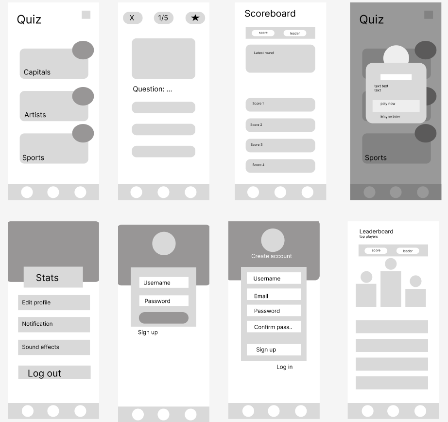
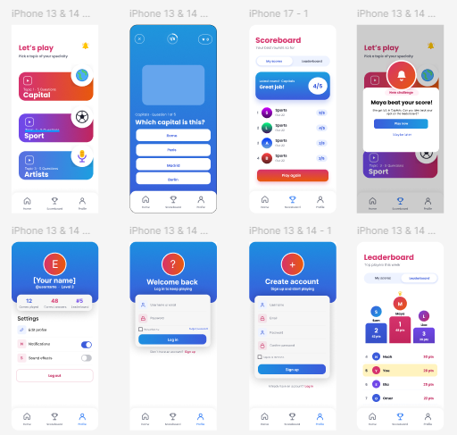

# Quiz-app
<<<<<<< HEAD

## Questions view

Open `pages/questions.html` with VS Code Live Server to preview Samuel's Questions view. This contribution contains HTML, CSS, 15 questions in JSON and five local photos. JavaScript gameplay is not connected yet.

See [Questions documentation](docs/questions.md) for the data model, responsive layout, JavaScript handoff and AI-assistance disclosure. [Photo credits](pages/question-credits.html) includes source links and licences.

Quiz app
A quiz app built with vanilla JavaScript, HTML and CSS. Users choose a topic, answer questions within a time limit and see their results.

Live app: [https://bucolic-heliotrope-3cc57f.netlify.app]

Team

Name
Github
Resposibility

Emma Hagelin  
EmmaHagelin
Home page and notification popup

Andrija Dokic
andrijadjokic07-png
Profile, login, signup

Samuel Gezai
SamuelGoitomGezai
Questions

Abdul Rahman Al Hanbili
abdul060
Scoreboard, footer, main.css

Gogita Nikabadze
teddyyGO
Leaderboard

How the app works:
The user signs up or logs in.
On the Home page, the user chooses a topic; Capitals, Artists or Sports.
The quiz starts with a time limit of 2 minutes.
The user answers the questions and get immediate feedback on each answer.
The result is saved in localStorage and shown on the Scoreboard page.
The Leaderboard page shows the user’s total points alongside other players.
The popup on the home page suggests what to play next, based on the latest round.
The Profile page shows the user’s statistics and settings.

Sketches

Wireframes

Figma design

Data model
{ 
"topic": "capitals", 
"difficulty": "easy", 
"questions": [ 
{ "id": 1, 
"question": "Which capital city is this?", 
"image": {
 "src": "../assets/questions/stockholm.jpg", 
"alt": "A waterfront lined with pastel-coloured historic buildings and steep red roofs.", "author": "OleNeitzel", 
"authorUrl": "https://commons.wikimedia.org/wiki/User:OleNeitzel", 
"license": "CC BY 4.0", 
"licenseUrl": "https://creativecommons.org/licenses/by/4.0/" }, 
"answers": [ 
{ "id": "stockholm", "text": "Stockholm" }, 
{ "id": "copenhagen", "text": "Copenhagen" }, 
{ "id": "oslo", "text": "Oslo" } ], 
"correctAnswerId": "stockholm", 
"topic": "capitals" } 
] 
}
 
Reflection

Strengths
We were good at working separately. In group discussions we had, we organized ourselves around different tasks which had to be done by certain deadlines that we chose. Everyone respected those deadlines. 
We were effective with the time we had working together, both on lectures and outside of them. 

Weaknesses
The connection between profile page and statics on leaderboard/question page is missing. (stats do not get applied on profile page)
It was challenging to organize ourselves, we had too little meetings with people not joining each time. 

What would we do differently?
Find better times which suits everyone. 

Use of AI
Emma Hagelin: Used AI to generate images based on our sketches. I compared the generated pictures to the sketches and checked that they matched our design before we used them in the app. I also used Claude to help with some debugging if stuck.

Andrija Dokic: I used AI for the assistance of giving me suggestions on how to approach making different modules and the whole profile system. LocalStorage() and import were new terms for me and other ones like try & catch were still new for me so I had problems writing the whole thing on my own. 

Andrija Dokic

Samuel Gezai

Abdul Rahman Al Hanbali 

Gogita Nikabadze

=======
>>>>>>> 2bee179c1224804e210e46bd3c710aa9abdb8343
